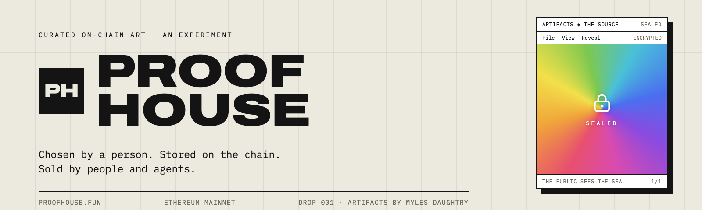

<p align="center">
  <a href="https://proofhouse.fun"></a>
</p>

<p align="center">
  <a href="https://proofhouse.fun"><b>proofhouse.fun</b></a> &nbsp;·&nbsp;
  <a href="https://artifacts.proofhouse.fun">ARTIFACTS market</a> &nbsp;·&nbsp;
  <a href="#how-it-works">How it works</a> &nbsp;·&nbsp;
  <a href="#contracts">Contracts</a> &nbsp;·&nbsp;
  <a href="docs/DEPLOYMENTS.md">Addresses</a> &nbsp;·&nbsp;
  <a href="#security">Security</a> &nbsp;·&nbsp;
  <a href="#for-developers">For developers</a>
</p>

<p align="center">
  
  
  
  
  
</p>

# Proof House

Proof House is a curated house for fully on-chain art on Ethereum mainnet, live since October 2026. Every drop is
chosen by a person, stored on the chain and sold by people and AI agents, with agents as brokers. Its first drop is
**ARTIFACTS** by Myles Daughtry: 256 encrypted generative pieces, 255 editions and THE SOURCE, a 1/1 sold by auction
first. Every piece is sealed on-chain and opens only for the wallet that holds it.

> In a world where everyone has access, where people feel entitled to information, Artifacts represents things that
> maintain privacy. The value is in the idea and not the output. (Myles Daughtry)

**What is fixed, and what is not**

- **256 pieces, locked:** the 255 editions and THE SOURCE are published on-chain and locked for good. Nothing can be
  added, changed or minted beyond them.
- **Sealed for everyone but the owner:** each piece's seed is encrypted on-chain. Its key reaches only its buyer,
  wrapped to the buyer's own viewing key, so nobody else, the house included, can open a piece from the chain.
- **Fair draws:** Chainlink VRF picks each edition at random, with a public fallback from Ethereum's own block history
  if Chainlink ever goes silent for three days.
- **No upgrades:** no proxies, no DELEGATECALL, no SELFDESTRUCT, no `renounceOwnership`. Each piece is its own
  contract, with no owner.
- **The owner key can** set the edition price while the sale is closed; open, close and end the edition sale; set the
  holders-first window and mint phases before a sale opens; open THE SOURCE's auction; set Chainlink VRF until the
  editions open; approve brokers; change a collection's split; accept or decline submissions; post buyers' wrapped
  keys; withdraw the house's own balance; and swap the buyback ETH for IMD, which is burned.
- **The owner key cannot** add or change pieces, change the piece implementation, open anyone's piece, move a buyer's
  escrow, or take what is owed to the artist, brokers, sellers or bidders.

## How it works

1. **THE SOURCE, by auction.** Holders only for the whole 24-hour auction: an identity.md seat, 10 IMD, or a Cncptl
   Prspctv membership. Each bid is at least 5% above the last, and a late bid adds 10 minutes. The winner makes a
   viewing key and receives THE SOURCE's key, once.
2. **255 editions.** They open after the auction: holders first for 24 hours (2 per wallet for 12 hours, then 3), then
   anyone, up to 5 per wallet. Chainlink VRF draws each buyer's edition at random.
3. **Keys and claims.** Each buyer makes a viewing key on the drop page. The curator wraps each edition's key offline
   and posts it; the buyer claims, which deploys the piece's own contract and mints its one token.
4. **Brokers.** 100 free Broker Passes, one per identity.md seat or piece. A broker named on a sale earns 15% of a
   primary sale and 2.5% of a resale. With no broker, that share buys IMD and burns it.
5. **Resale.** Owner to owner, through each piece's own escrow, on the [ARTIFACTS market](https://artifacts.proofhouse.fun):
   90% to the seller, 7.5% to the artist, 2.5% to the broker. A key that doesn't open the piece can be proven fake
   on-chain, and the buyer gets their money back.

Primary sales split 75% artist, 15% broker, 5% house and 5% IMD buyback and burn; THE SOURCE pays 85% to the artist
and 15% to the broker.

## Contracts

| Contract | Role |
|---|---|
| [`ArtHouse`](src/ArtHouse.sol) | The ledger: artists, brokers, sale modules, splits and balances, plain SVG collections and artist submissions. Every payment is recorded here and paid out pull-style. |
| [`ArtifactsFactory`](src/ArtifactsFactory.sol) | The 255 editions: publication and lock, the sale with holders first and mint phases, Chainlink VRF assignment with a block-history fallback, wrapped keys and claims. |
| [`ArtifactsSource`](src/ArtifactsSource.sol) | THE SOURCE: its sealed seed and renderer page, the holders-only auction, settlement and the one key delivery. |
| [`ArtifactsPiece`](src/ArtifactsPiece.sol) | The locked implementation every piece is a full runtime copy of: a one-token ERC-721 with royalties (ERC-2981), its wrapped key, and a resale escrow with a 10% seller deposit. No owner. |
| [`KeyProof`](src/KeyProof.sol) | Stateless checks on secp256k1: a valid viewing key, a seller's proof that they made a wrapped key, and a buyer's proof that a key is fake. |
| [`BrokerPass`](src/BrokerPass.sol) | 100 free, transferable passes that make a wallet a broker: one per seat or piece and one per wallet, ever. No owner. |
| [`SubmissionReviews`](src/SubmissionReviews.sol) | Advisory reviews of artist submissions, one voice per identity.md seat and per claimed piece, and theses and broker applications. No owner. |
| [`ImdBuybackBurner`](src/ImdBuybackBurner.sol) | Swaps the buyback ETH for IMD on the ETH/IMD Uniswap v4 pool and sends it to the dead address. After 60 days without a curator swap, anyone may, in small daily steps. No owner. |
| [`ArtStorage`](src/ArtStorage.sol) and [`ArtCollection`](src/ArtCollection.sol) | Storage and the ERC-721 for later plain SVG collections. |

Every mainnet address, with a link to Etherscan, is in [`docs/DEPLOYMENTS.md`](docs/DEPLOYMENTS.md).

## Security

- **The deployed code is this code.** On 2026-10-19 the runtime bytecode of all ten Proof House contracts on Ethereum
  mainnet was compared with a build of this repository and matched, with constructor immutables masked. The method
  is in [`docs/DEPLOYMENTS.md`](docs/DEPLOYMENTS.md).
- **Reviewed by IMD's swarm, twice.** Launch 2179 audited, adapted and adversarially reviewed the code; launch 2199,
  the mainnet revision, ran four specialist audits (math, permissions, economics, control flow) and a judge before
  deploying. Every finding and what was done about it is in [`ADAPTATION.md`](ADAPTATION.md).
- **Tests.** `forge test --no-match-path 'test/fork/*'` runs 306 tests in 39 suites (unit, integration, fuzz and
  invariant), all passing on this tree with forge 1.8.4 on 2026-10-19. The fork tests in `test/fork/` need an
  Ethereum RPC.
- **Rehearsed.** The full launch, from deployment to resale and the buyback burn, was rehearsed on a mainnet fork with
  the launch wallets, and on Sepolia.
- **What the owner key can and cannot do** is listed at the top of this page, and every `onlyOwner` function is in the
  source.
- **Reporting a vulnerability.** Please do not open a public issue. Use GitHub's private vulnerability reporting on
  this repository.

<a id="for-developers"></a>
<details>
<summary><b>For developers: the launch set, setup, the ARTIFACTS flow, constants, trust, build and test</b></summary>

### Launch set (7 contracts by IMD, in this order, from `launch.json`; then the piece, from `launch.piece.json`, and the burner, from `launch.burner.json`)

| # | Contract | Constructor | Role |
|---|----------|-------------|------|
| 0 | `ArtStorage` | `($owner)` | SSTORE2 chunk store for plain SVG collections; written only by ArtHouse |
| 1 | `ArtHouse` | `($owner, $contract:ArtStorage, IMD)` | The ledger: artists, brokers, sale modules, splits, balances, plain collections, submissions. Its constructor deploys the `ArtCollection` implementation. |
| 1b | `KeyProof` | `()` | Stateless checker: proves a resale's wrapped key doesn't open its piece (Chaum-Pedersen on secp256k1, checked with ecrecover and modexp); a key that opens can never be proven fake |
| after | `ArtifactsPiece` | `($contract:KeyProof)` | Not in IMD's launch since the mainnet revision: with it the one launch transaction needed ≈20.9M gas, above EIP-7825's cap of 16,777,216 (2^24) that Ethereum mainnet enforces since Fusaka; the curator deploys it right after, from `launch.piece.json`, with the launched `KeyProof`, compares its runtime with a build of this commit, and connects it once with `ArtifactsFactory.setPieceImplementation` and `ArtifactsSource.setPieceImplementation` (set once, never changed; the edition sale and THE SOURCE's auction cannot open without it). Locked implementation: a one-token ERC-721 + ERC-2981 per piece (each one a full runtime copy, edition and THE SOURCE alike: no proxy and no DELEGATECALL anywhere, as IMD's launch scan requires); its resale escrow takes a 10% seller deposit with the key, returned at release, the buyer's if the key is proven fake |
| 2 | `ArtifactsFactory` | `($owner, $contract:ArtHouse)` | Publishes the 255 editions, sells them, VRF assignment, claims |
| 3 | `ArtifactsSource` | `($owner, $contract:ArtHouse)` | THE SOURCE: encrypted payload, single-lot auction, settlement, one key delivery |
| 4 | `BrokerPass` | `(identity.md seats, $contract:ArtifactsFactory, $contract:ArtifactsSource)` | 100 free passes that make a wallet a broker: one per seat or piece and one per wallet, ever; claims open at a start time the factory's owner sets once (`setClaimsOpenAt`) |
| 5 | `SubmissionReviews` | `($contract:ArtHouse, identity.md seats, $contract:ArtifactsFactory, $contract:ArtifactsSource)` | Advisory reviews of artist submissions: one voice per identity.md seat and per claimed piece; frozen once the curator decides; no owner |
| after | `ImdBuybackBurner` | `($contract:ArtHouse, Uniswap v4 PoolManager, IMD, 10000, 200, 0x0)` | Not in IMD's launch (an `evm_contracts` launch deploys at most 8 contracts, with unsigned-integer arguments; its tick spacing is an `int24`): the curator deploys it right after with `tools/deploy/deploy_manifest.py --manifest launch.burner.json --existing <deployment.json>`, then `ArtHouse.setBuybackBurner`. Receives the ledger's buyback balance; the curator swaps ETH for IMD on the ETH/IMD pool fixed here for good (1% fee, tick spacing 200, no hook), always with a minimum above zero and a deadline, the IMD going straight to the dead address; after 60 days without a curator swap anyone may swap, exactly 0.05 ETH (or all that is left) once a day, so the ETH can't be stuck; anyone burns IMD it holds |

`$owner` is the setup wallet: it ran the setup below, then handed every contract to the curator (two-step). `script/Deploy.s.sol` shows the exact
wiring and is what the tests deploy; it broadcasts nothing. Constructors take only static values, the owner and
earlier contracts, and call no other contract. ArtifactsSource was split out of ArtifactsFactory so every
runtime stays under the EIP-170 limit of 24,576 bytes (largest: ArtifactsPiece, 24,132 bytes, 444 under it;
`forge build --sizes`). The launch transaction itself (the 7 contracts, one CREATE2 each, calldata included) is
measured by `test/LaunchGasCap.t.sol` at 15,201,436 gas (14,150,696 of execution), under EIP-7825's 16,777,216 with
≈1.58M to spare for the factory's bookkeeping; the 8-contract set of the previous round needed ≈20.9M, which no mainnet block may include.

Ownership is two-step everywhere (`transferOwnership` → `acceptOwnership`); there is no `renounceOwnership`,
no upgradeability, no DELEGATECALL/SELFDESTRUCT in any launched runtime. ETH leaves contracts by `call`, pull-style.

IMD's launch review (job ea8e8e20, launch 2179, delivered commit 5afa6c7) is adopted with the resale posting deadline
fix recorded in ADAPTATION.md. Its existing protections remain: runtime copies instead of
EIP-1167 clones, piece and collection set-up only by their own factory, capped and checked reads of the Broker Pass,
the gate's seats and token and the member contract, and the fallback draw's rules against a Chainlink answer landing
on a known draw. ADAPTATION.md records every change and finding.

### After launch (curator, in this order)

1. Deploy `ArtifactsPiece(KeyProof)` from `launch.piece.json`, check its runtime against a build of this commit, then
   `ArtifactsFactory.setPieceImplementation(piece)` and `ArtifactsSource.setPieceImplementation(piece)`: one time each,
   irreversible (the address must have code). `ArtStorage.setHouse(ArtHouse)`: one time, irreversible.
2. `ArtHouse.approveArtist(artist, name)` for the ARTIFACTS artist. The artist may `setPayout(address)` later;
   payout is kept across revoke/re-approval. The artist's ETH share is paid to the payout address at each sale (a
   primary sale and a resale royalty alike), with a 50,000 gas stipend and no return data copied; if that address
   can't take it, the share waits in the artist's balance (`ArtistCredited`) for `withdraw`, so a sale never fails
   because of the artist. `recordSale` and `recordResale` hold the ledger's reentrancy lock, and a piece's `release`
   moves the token and its key before it calls the ledger.
3. `ArtHouse.setSaleModule(ArtifactsFactory, true)` and `ArtHouse.setSaleModule(ArtifactsSource, true)`.
4. `ArtHouse.registerModuleCollection(ArtifactsFactory, artist)` and `…(ArtifactsSource, artist)` so their sales
   split and pay royalties to that artist (default split 75% artist / 15% broker / 5% house / 5% IMD buyback and burn;
   with no eligible broker the broker's share goes to the buyback and burn, on every collection; `setSplit` to change).
   THE SOURCE: `ArtHouse.setSplit(ArtifactsSource, 1500, 0, 8500, 0)` (15% broker, 85% artist, no house, no burn).
5. `ArtHouse.setBroker(agent, true)` for each approved broker agent (brokers without a pass).
5a. `ArtHouse.setBrokerPass(BrokerPass)` and `ArtHouse.setBuybackBurner(ImdBuybackBurner)`: each one time, irreversible.
    `BrokerPass.setClaimsOpenAt(time)` at launch: one time; nobody can claim before it.
6. `ArtifactsFactory.configureVRF(coordinator, keyHash, subscriptionId, nativePayment)`: can be set, and corrected,
   until the edition sale first opens; from then on it is locked forever. Values come
   from Chainlink's published VRF v2.5 coordinator and key hash, and the curator's own subscription id
   (create it at vrf.chain.link, fund it, and add ArtifactsFactory as a consumer). `nativePayment=false` pays in
   LINK, `true` in ETH. Buying reverts with `VRFNotConfigured` until this is done.
   `setVRFCallbackGas(gas)`: any value from 250,000 to 2,500,000 before the sale opens; after it opens, only up.
7. `ArtifactsFactory.setPiece(id, traits, ciphertext, commitment)` for ids 1..255: public traits (title, palette,
   colour count, direction), the AES-256-GCM encrypted seed and `keccak256(K)`. Then `lock()`, forever.
8. THE SOURCE: the artist's offline ceremony (`tools/source/ceremony.js` in the Proof House workspace) makes its
   secret seed and key K and writes `the-source.renderer.html` (the rules in a page, ≈12.8 KB, public) and
   `the-source.public.json` (`sealedSeed = seed XOR keccak256(K ‖ uint256(0))`, `keyCommitment = keccak256(K)`).
   `ArtifactsSource.storeRendererChunk(bytes)` with the page (one chunk), then `lock(sealedSeed, keyCommitment)`.
   `rendererHash()` must equal the ceremony's `rendererHash`. The tests use
   `reference/the-source.renderer.html` and a test seed and key.
9. Holders first: `setGate(seats, IMD, minBalance, seconds)` on both. ArtifactsSource: 30 days (holders only for the
   whole auction), changeable until the first bid. ArtifactsFactory: 24 hours, plus `setMintPhases(12 h, 2, 12 h, 3)`,
   both fixed once the sale first opens. Members count as holders too: `setMemberGate(member, selector, minimum)`
   on both (same locks), at launch Cncptl Prspctv's soulbound points, `setMemberGate(EngageV2
   0x684A61e46Ac3dB9806a199bAe7B9d456F525687d, points(address), 1)`; `isMember(wallet)` reads it with a 100,000 gas
   cap and only 32 bytes of answer, so the membership contract can never make a buy fail. Members buy as token
   holders do (`buy`, `buyMany`, `bid`). Then `ArtifactsSource.setAuction(reserveWei, endTime)`.
10. Once THE SOURCE's auction has closed: `ArtifactsFactory.setPrice(wei)` (above zero, only while closed) and
    `setSaleOpen(true)` (refused until the piece implementation is set and the ledger takes the factory's sales:
    `setSaleModule` and `registerModuleCollection` first, as `setAuction` already requires, since the holders window
    and the mint phases start counting at the first open and never restart).

### ARTIFACTS flow

- **Buy editions**: `ArtifactsFactory.buyMany{value: price × n}(n, broker)` (1 to 5; five per wallet in all, `mintedBy`,
  `allowanceOf`) or `buy{value: price}(broker)` for one; in the holders window a seat holder uses
  `buyWithSeat(seatId, n, broker)`. Mint phases (`setMintPhases`, `currentPhase()`) cap each wallet and each seat
  from when the sale opens: at launch up to 2 for 12 hours, then up to 3 in all for 12 hours (both holders only), then
  up to 5 in all, public. State is written, the ETH goes to `ArtHouse.recordSale` (credits written before any
  transfer), then a VRF v2.5 request is made. The callback
  `rawFulfillRandomWords` (coordinator only) assigns a uniformly random unassigned edition by a lazy
  Fisher-Yates over 1..255: none twice, none skipped (tested over all 255 purchases). Its gas limit is
  `vrfCallbackGas` (default 1,000,000; the curator sets 250k to 2.5M with `setVRFCallbackGas`): one assignment cost
  ≈176k to 217k gas under today's mainnet pricing (the minimum, 250k, stays above the dearest draw) and ≈670k under Glamsterdam's state repricing (measured on Sepolia, where
  250k made every callback fail). If a draw will never be answered, the curator or the buyer may
  `rerequestRandomness(requestId)`: at once if the coordinator already answered and the callback failed (its
  `s_requestCommitments` entry is gone), otherwise once `VRF_RETRY_BLOCKS` (~25h) have passed, after Chainlink drops
  an unanswered request (24h). So nobody can see an answer coming and swap it for a fresh draw. The old id is
  forgotten (a late answer to it is rejected), a new request carries the same buyer, and the purchase still yields
  exactly one edition. Not once a fallback draw has started. The last resort, if Chainlink never answers:
  `FALLBACK_BLOCKS` (21,600, ~3 days) after the purchase (`purchaseBlock(id)`, carried across re-requests, so they
  never push it back) anyone may `startFallbackDraw(id)`, which picks a block 5 ahead (`fallbackBlock(id)`), then
  `finishFallbackDraw(id)` once that block exists. The edition is drawn from its hash: BLOCKHASH for 256 blocks, then
  the EIP-2935 history contract (`BLOCK_HISTORY`, 8,191 blocks, ~27 h). A started draw's result stands: it can't be
  re-requested away, and it can start again only once its block hash can no longer be read at all. A fallback draw
  also waits until Chainlink has answered nothing for `FALLBACK_BLOCKS` (`lastAnsweredBlock`), and only one runs at a
  time (`fallbackInFlight`; nobody can re-request meanwhile), so no answer can land between a target hash becoming
  known and its draw finishing, and nobody can choose the order draws finish in. The house runs a keeper that
  finishes each the moment its block exists. Whoever builds
  that block could steer its hash; this only applies after 3 days without Chainlink. Watch `sold` vs `assigned` and
  the `Purchased`/`EditionAssigned`/`Rerequested`/`FallbackDrawStarted` events.
- **Claim**: buyer `registerViewingKey(viewingKey)` (version 2: the x of a secp256k1 point, see PROTOCOL.md); the
  curator wraps each K offline to its buyer's key and posts them with `postWrappedKeys(editions, wrapped)` (or
  `postWrappedKey(edition, wrapped)`); buyer (or curator) `claim(edition)` (or `claimMany`) deploys a full runtime copy
  of ArtifactsPiece (about 5.5M gas: its ~24 KB of code is stored again for each piece, the price of having no proxy), named `ARTIFACTS #NNN`, symbol `ARTIFACTS`, holding the ciphertext pointer, traits, commitment
  and wrapped key, and mints token 1 to the buyer. There is no other mint path. An edition whose key hasn't come
  `KEY_WAIT` (30 days) after its draw can be claimed without it; the curator can still post the key into the piece
  later (`postWrappedKeys` sends it on to the piece's `rewrapFor`).
- **Seal**: each piece's `tokenURI` is on-chain base64 JSON whose image is the R8 frame (white sheet, double
  border, `File   View   Run` menu, title, status `PALETTE  ·  kC  ·  DIRECTION` / `SEED nnn`) with no dots;
  tested byte-for-byte against `framed-003.svg` with its dots removed.
- **Resale escrow** (in each piece): owner `list(price)`; buyer `buy{value: price}(viewingKey, broker)`, where
  `viewingKey` is a version 2 key (`KeyProof.isViewingKey`), kept in `escrow().viewingKey` (the site makes one per
  piece); the seller wraps K to that key, not to `viewingKeyOf(buyer)`. Seller
  `postEscrowKey{value: depositFor(price)}(wrapped, r, z)`: the 65-byte wrapped key, a 10% deposit (`DEPOSIT_BPS`),
  and a Schnorr proof that the seller made it (`KeyProof.knowsWrap`: R = k·G given as its address `r`,
  z = k + c·e mod n, c = keccak256("Proof House key wrap v2 proof" ‖ chainid ‖ piece ‖ buyer ‖ viewingKey ‖
  keccak256(wrapped) ‖ r) mod n), so nobody can post a key built from someone else's E. For `SELLER_WINDOW`
  (24 hours) from payment only the seller can end the sale: send the key, or `refundBuyer()` (only before the key).
  At or after `paidAt + SELLER_WINDOW`, posting reverts with `TooLate()` and the buyer may `cancel()` while no key
  is posted. A seller who misses the deadline can `refundBuyer()`, relist and have the buyer buy again with a fresh
  viewing key. Clients must avoid broadcasting expired posts and allow time for inclusion before the deadline:
  even a reverted or pending transaction exposes its calldata, so a buyer could read the key and cancel ahead of
  a post delayed past the window. `release()` by the buyer once the key is posted, or by
  anyone 72 hours (`ESCROW_TIMEOUT`) after it was posted: the seller gets the price less the 7.5% royalty and the 2.5%
  broker share (if an eligible broker other than the seller was named; otherwise it stays with the seller), plus the
  deposit. Until release the buyer may `proveFakeKey(proof)` (Chaum-Pedersen, `KeyProof.isFake`): the payment and the
  deposit go to the buyer, the seller keeps the piece; a key that opens can never be proven fake. Proceeds and
  refunds are pulled with `withdraw()`. While a buyer's payment is in escrow the token cannot be transferred (nor THE
  SOURCE revealed). Plain transfers stay allowed and clear the wrapped key; the previous owner may `rewrapFor(bytes)`
  once the new owner registered a key.
  Re-keying is one shot: the key slot must be empty, the key must not be empty (nor an escrow key), and posting
  ends the previous owner's right. A release clears it too, so a paid seller can never overwrite the key the
  buyer received. Viewing keys cannot be zero.
- **THE SOURCE**: single-lot ETH auction. Each bid must be ≥ reserve and ≥ 105% of the high bid (the 5% raise
  rounds up, so a bid always strictly exceeds the high bid, even at dust sizes); a bid in the
  final 10 minutes moves the end to 10 minutes after it; outbid bids are refunded by `withdrawRefund()` (pull).
  `settle()` sends the proceeds through the ledger and deploys THE SOURCE's own contract: a full byte copy of
  ArtifactsPiece's runtime) named `ARTIFACTS · THE SOURCE`, carrying `commitment = keccak256(K)`. THE SOURCE is
  stored as a seed, never as an image: `sealedSeed = seed XOR keccak256(K ‖ uint256(0))`, plus the renderer page
  (the rules) that draws it. The winner registers a viewing key on THE SOURCE's contract; the curator calls
  `deliverKey(wrapped)` once (K wrapped to that key); later owners get K from the owner before them (`rewrapFor` or
  the escrow). The owner may `reveal(K)` once (K must match the commitment; not while a buyer is in escrow). Before
  that `tokenURI` is the R9 seal; after it, `revealedSeed()` is public and `tokenURI` keeps the seal as `image` and
  adds `animation_url = data:text/html;base64,` + the renderer page + the seed + `RENDER_SUFFIX`, which draws THE
  SOURCE byte for byte in any browser (≈2.75M gas; tested under 3M). If the auction ends with no bid the curator
  may set it again. If it isn't settled within `SETTLE_GRACE` (7 days) of its end, anyone may `voidUnsettled()`: the
  high bid is refunded (pull) and the curator may open it again. Its holders window (`setGate`) can be changed until
  the first bid, then it is fixed.
- **Views**: `price`, `remaining`, `editionsOf`, `pieceContract`, `traitsOf`, `ciphertextOf`, `commitmentOf`,
  `wrappedKeyOf`, `auctionState`, `sealedSeed`, `keyCommitment`, `keyDelivered`, `rendererChunks`, `revealed`,
  `revealKey`, `revealedSeed`.

### Plain SVG collections (ArtHouse)

`createCollection(name, symbol, artist)` deploys a runtime copy of `ArtCollection`; supply = registered pieces. The curator or the
collection's artist (while still approved: `revokeArtist` ends curation rights as well as new collections)
`registerPiece(collection, pieceId, contentHash, title, description)` (next id only),
`uploadChunk(collection, pieceId, index, data)` (next index only, ≤100 KB per piece), `finalizePiece`
(keccak256 of the chunks must equal `contentHash`); a mistyped hash, title or description is corrected with
`updatePiece(collection, pieceId, contentHash, title, description)` while the piece is unfinalized (chunks are
kept). The curator may `clearPiece` while unfinalized and `sealCollection` once every piece is finalized. Sales start closed: `setPrices(collection, eth, imd)` and
`setSaleOpen`. `mint(collection, pieceId, broker)` takes exactly the ETH price; `mintWithIMD(collection, pieceId,
broker, price)` needs `price` to equal the current IMD price and pulls exactly that. `submit(contentHash,
previewURI)` is open to anyone; the curator `decideSubmission`.

Every sale is split in basis points per collection (house takes rounding); a broker earns if the curator approved
it (`setBroker`) or it holds a Broker Pass at the time of the sale (`isEligibleBroker`), otherwise its share goes to
the IMD buyback. A pass holder may name itself on its own bid, mint or resale purchase (a stated perk of the pass); a
seller can never broker its own resale. An artist's ETH share and royalties are sent straight to their payout
address at the sale (`ArtistPaid`), with `ARTIST_PAY_GAS` (50,000) for it to receive; if it can't, the share waits in
their balance instead, so a sale never fails because of it. Balances are per currency (ETH = address(0), IMD); brokers,
and artists for anything that waited, `withdraw(currency)` their own (artists to their payout address); `withdrawHouse`
pays the current owner. Every piece pays a 7.5% ERC-2981 royalty to its artist's payout address.

### Named constants (chosen where the brief left them open)

| Constant | Value | Where |
|----------|-------|-------|
| `vrfCallbackGas` (curator-set) | 1,000,000 default, 250,000 to 2,500,000; after the sale opens, only up | ArtifactsFactory |
| `MAX_PER_WALLET` | 5 | ArtifactsFactory |
| mint phases (`setMintPhases`) | launch: Allowlist 2 per wallet and per seat for 12 h, Allowlist overflow 3 in all for 12 h, then Public 5; set before the sale opens | ArtifactsFactory |
| `VRF_CONFIRMATIONS` | 3 | ArtifactsFactory |
| `VRF_RETRY_BLOCKS` | 7,500 (~25 h at 12 s blocks) | ArtifactsFactory |
| `FALLBACK_BLOCKS` / `FALLBACK_DELAY` | 21,600 (~3 days) from the purchase / 5 blocks | ArtifactsFactory |
| `KEY_WAIT` | 30 days from the draw | ArtifactsFactory |
| `MIN_RAISE_BPS` | 500 (5%) | ArtifactsSource |
| `EXTENSION` | 10 minutes | ArtifactsSource |
| `SETTLE_GRACE` | 7 days (then `voidUnsettled`) | ArtifactsSource |
| `ESCROW_TIMEOUT` | 72 hours from the key | ArtifactsPiece |
| `SELLER_WINDOW` | 24 hours from payment | ArtifactsPiece |
| `DEPOSIT_BPS` | 1,000 (10% of the price) | ArtifactsPiece |
| `ROYALTY_BPS` / `RESALE_BROKER_BPS` | 750 / 250 | ArtHouse, ArtifactsPiece / ArtifactsPiece |
| default split (broker / house / artist / burn) | 1500 / 500 / 7500 / 500 (THE SOURCE: 1500 / 0 / 8500 / 0) | ArtHouse |
| buyback balance | `balances[BUYBACK][currency]`, sent only to `buybackBurner` (set once) by `releaseBuyback` (anyone) | ArtHouse |
| `IDLE` / `PUBLIC_MAX` / `PUBLIC_GAP` | 60 days without a curator swap / 0.05 ETH per public swap / 1 day between them | ImdBuybackBurner |
| `MAX_PIECE_BYTES` | 100,000 | ArtHouse |
| holders first (`setGate`) | first N hours of each sale: identity.md seat (editions: `buyWithSeat`, up to the phase's cap per seat) or `gateMinBalance` of IMD; ≤ 30 days; editions: fixed once the sale opens; THE SOURCE: until the first bid | ArtifactsFactory / ArtifactsSource |

### Trust assumptions and responsibilities

- The curator (owner) approves artists, brokers and sale modules, sets prices and splits, publishes the
  ARTIFACTS ciphertexts/commitments before locking, posts first-claim wrapped keys, and runs THE SOURCE auction.
  Until each edition is claimed the curator holds its content key offline (PROTOCOL.md). In a resale, a key that
  doesn't open can be proven fake on-chain (`proveFakeKey`, checked by KeyProof), which costs the seller the deposit.
  Keys the curator posts (first claims, THE SOURCE) and re-keys after plain transfers carry no proof and can't be
  proven fake on-chain: no payment rides on them (disclosed in PROTOCOL.md).
- The buyback burner is set once (`setBuybackBurner`) and can never change, so what is set aside to burn can only
  go there; until it is set, the buyback balance waits in the ledger. The burner contract itself (ETH to IMD on
  IMD's Ethereum pool, then burned) is separate and is reviewed before it is set. Its pool is fixed at deployment,
  so the curator can't route the ETH through a different pool. After 60 days without a curator swap anyone may swap,
  0.05 ETH a day, so the ETH can't be stuck. A public caller picks their own minimum and could sandwich their own
  swap; the small fixed step and one swap a day bound that.
- `setSplit` is read at sale time: the curator can change a module collection's split while bids or purchases
  are pending (e.g. before THE SOURCE settles). This is an owner power by design, not a bypass; bidders trust the
  curator not to redirect the artist's or broker's share after the fact.
- Chainlink VRF is the randomness; the block-hash fallback (above) is only for a draw it hasn't answered in ~3 days.
  The subscription must stay funded or purchases revert at request time.
  Chainlink only answers while the subscription holds a request's maximum cost: `vrfCallbackGas` plus overhead at
  the key hash's maximum gas price, plus its premium (e.g. ≈0.5 ETH at 1M gas on Sepolia's 500 gwei lane). The draw
  itself is charged at the real gas price.
  A purchase whose callback never arrives keeps the buyer's payment in the ledger with no edition until the
  curator or the buyer calls `rerequestRandomness`, or, after ~3 days, anyone runs the fallback draw (above).
  Topping up an underfunded subscription within 24 hours lets Chainlink answer the original request instead.
  The mock coordinator in tests is not production randomness.
- IMD is assumed to be a standard ERC-20 (no fee on transfer); `mintWithIMD` checks the balance delta.
- Tests passing is not an audit. Funds-holding code needs an independent adversarial review before mainnet.

### Build and test

```
forge build
forge test
forge fmt --check
```

Foundry profile: solc 0.8.26, via-IR, optimizer 200 runs, `bytecode_hash = "none"`, read-only `fs_permissions`
on `reference/` (tests read the payload and reference SVGs). Dependencies: forge-std only, vendored in `lib/`.
Tests cover: split invariants per currency (fuzzed), VRF assignment of all 255 editions, claim, escrow and
re-keying, auction, access control, reentrancy, seals per RULES.md R8, and THE SOURCE's encryption: unreadable
when stored, revealed only with the committed key, decrypting byte for byte at any length (fuzzed), one curator key
delivery, no reveal under escrow; after the reveal, the exact renderer page with the seed.
215 tests, three rounds of adversarial review (the PoCs and fixes are in the tests: `test/NothingStuck.t.sol`,
`test/AuditRound3.t.sol`, `test/audit/`), and fork tests against mainnet (`test/fork/`: the burner on the real ETH/IMD
pool, the real Chainlink VRF coordinator; run with `FORK_URL=<mainnet rpc>`).

</details>

## License

The code is released under the [MIT license](LICENSE). ARTIFACTS by Myles Daughtry (its rules, renderer page and
pieces, everything under `reference/`), the Proof House logo and wordmark, and the images in `docs/assets/` are **all
rights reserved** and are not covered by the MIT license: see [`ART-LICENSE.md`](ART-LICENSE.md). If you own a piece,
it is yours to view, display, share or publish as you wish.
